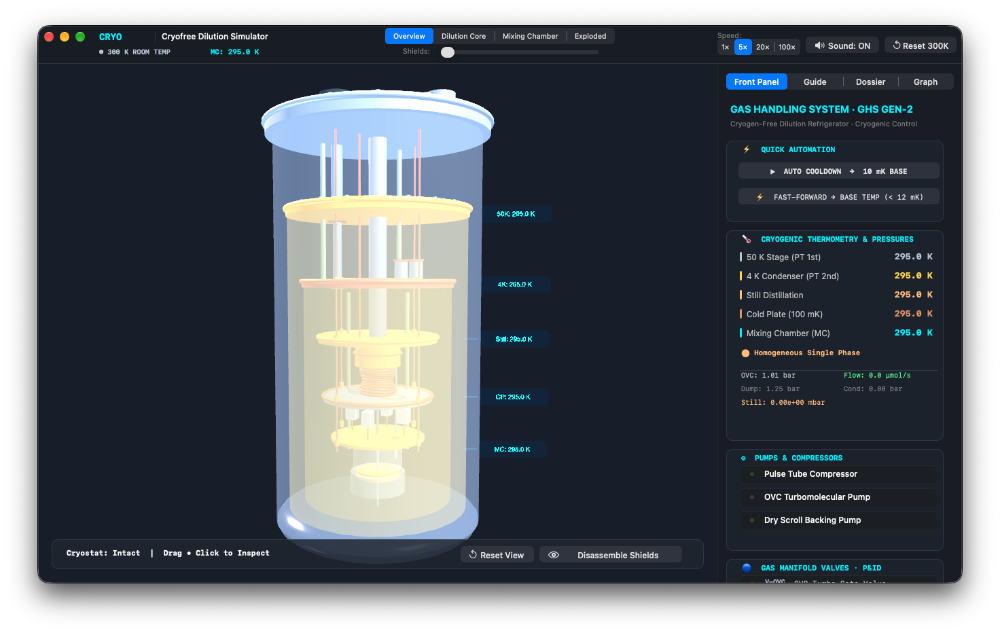

# Cryogen-Free Dilution Refrigerator Simulator

A native macOS application for exploring a modern cryogen-free dilution refrigerator in 3D. Built in pure **Objective-C** with **AppKit**, **SceneKit**, and **CoreGraphics**, the simulator combines an interactive cryostat model with a live thermodynamic engine, gas-handling controls, and a guided cooldown procedure.



*The 300 K overview: fully assembled cryostat, live stage temperatures, and the GHS front panel.*

**Version 1.0.0 · macOS 12+ · No external dependencies**

---

## Overview

Dilution refrigerators are the workhorse cooling systems behind superconducting quantum computers, spin-qubit experiments, and ultra-low-temperature condensed-matter research. This simulator models a dry, pulse-tube-based system: no liquid helium bath, a ³He/⁴He dilution circuit, and a gas-handling system that takes the cryostat from room temperature to the millikelvin regime.

The application is designed both as an interactive visualisation and as a teaching tool. You can operate the valves and pumps manually, follow a nine-step cooldown, jump directly to a running dilution stage, and inspect the purpose and construction of every major component.

## Highlights

### Interactive 3D cryostat

- Procedural, high-detail model of the full cryostat assembly:
  - 300 K outer vacuum chamber (OVC), top flange, viewports, and support structure
  - Pulse-tube cryocooler with 50 K and 4 K stages
  - Gold-plated 50 K radiation shield and polished 4 K shield
  - Still chamber, continuous spiral heat exchanger, and cold plate
  - Sintered-silver step heat exchangers
  - Mixing chamber with visible ³He/⁴He phase boundary
  - Sample puck, gold shielding, and microwave/DC wiring with cryogenic attenuators
- Physically based materials and a stable scientific-instrument look.
- Continuous explode slider plus **Overview**, **Dilution Core**, **Mixing Chamber**, and **Exploded** camera presets.
- Click any component or floating badge to open its technical dossier.
- Live 3D temperature badges and animated ³He flow particles.
- Reset View preserves the current shield configuration; Reset 300K returns the simulation to room temperature.

### Dilution refrigeration physics

- ³He/⁴He mixture thermodynamics with a concentrated ³He phase and a ⁴He-rich dilute phase.
- Phase separation below approximately 0.87 K, with a finite ³He solubility of about 6.6% as temperature approaches zero.
- Still distillation at roughly 0.7–0.9 K, where ³He has a much higher vapour pressure than ⁴He.
- Endothermic heat absorption at the phase boundary in the mixing chamber:

  $$
  \dot{Q}_{MC} = \dot{n}_3 \left(84\,T_{MC}^{2} - 12\,T_{ex}^{2}\right) - \dot{Q}_{parasitic}
  $$

- Lumped thermal capacities, realistic time constants, parasitic heat loads, and conduction paths.
- Closed-loop PID control of the mixing-chamber heater.
- Live temperatures for the 50 K stage, 4 K stage, still, cold plate, and mixing chamber, plus line pressures and ³He circulation rate.

### Gas handling and control room

The right-hand instrumentation panel contains four workspaces:

1. **Front Panel** — the GHS Gen 2 mimic:
   - Pulse-tube compressor, OVC turbomolecular pump, and dry scroll backing pump
   - Manifold valves: V-OVC, V1 (dump supply), V2 (dump return), V3 (still backing), V4 (circulation), V5 (condense injection), and V6 (bypass)
   - Still heater and mixing-chamber heater with PID setpoint control
   - Live temperature, pressure, and flow telemetry
   - **Auto Cooldown** and **Fast-Forward to Base Temperature** shortcuts
2. **Guide** — a nine-step cooldown and recovery procedure in a 3×3 grid:
   - Room → Vacuum → Pre-Cool → Purge → Condense → Circulate → Two-Phase → Base 10 mK → Recovery
   - Previous/Next navigation and per-step auto-execution
   - Operational guidance and physics explanations
3. **Dossier** — component-by-component reference material:
   - Materials, operating temperatures, construction, and cryogenic function
   - Kapitza-resistance mitigation and thermal-anchoring notes
   - Quantum-computing context
   - Focus-in-3D action that opens the necessary shields and frames the selected stage
4. **Graph** — a live multi-trace temperature strip chart:
   - Logarithmic scale from 10 mK to 300 K
   - Linear 0–1000 mK mixing-chamber zoom
   - Live values in the legend for all five temperature stages

### Additional features

- Workflow speed control: 1×, 5×, 20×, and 100×.
- Procedural cryogenic audio: pulse-tube compressor rhythm, valve clicks, and pump feedback, with a mute control.
- Dark instrumentation theme with cryogenic cyan, phosphor amber, quantum violet, and gold accents.
- Responsive AppKit layout with a fixed top control bar, 3D viewport, and right-side instrumentation panel.
- Native keyboard shortcuts, camera presets, and click-to-inspect interactions.

---

## Quick start

### Requirements

- macOS 12 Monterey or later
- Xcode Command Line Tools, or a full Xcode installation

Check that the compiler is available:

```bash
xcode-select -p
```

### Build from Terminal

```bash
./build.sh
open build/DilutionCryofreeSimulator.app
```

`build.sh` compiles all Objective-C sources with `clang`, packages the `.app` bundle, copies `Resources/Info.plist`, and ad-hoc signs the result.

### Build with Xcode

```bash
open DilutionCryofreeSimulator.xcodeproj
```

Then press **⌘R** to build and run.

### First run

1. Launch the app with `open build/DilutionCryofreeSimulator.app`.
2. Open the **Front Panel** tab and click **AUTO COOLDOWN → 10 mK BASE**, or open **Guide** and jump to **Base 10mK**.
3. Watch the mixing chamber reach its base temperature in the **Graph** tab and the floating 3D badges.
4. Drag in the viewport to orbit, scroll or pinch to zoom, and click any component to inspect it.
5. Use the **Shields** slider or **Disassemble Shields** to reveal the dilution core, then try the camera presets.

---

## Controls

| Action | Control |
| --- | --- |
| Orbit the cryostat | Left-click and drag in the 3D viewport |
| Zoom | Scroll wheel or trackpad pinch |
| Inspect a component | Click the component or its temperature badge |
| Reset the camera | **Reset View** in the viewport HUD |
| Open the shields | **Shields** slider in the top bar, or **Disassemble Shields** |
| Change camera preset | **Overview**, **Dilution Core**, **Mixing Chamber**, or **Exploded** |
| Return to room temperature | **Reset 300K** in the top bar |
| Accelerate the simulation | **1× / 5× / 20× / 100×** speed control |
| Mute audio | **Sound: ON / MUTED** |

### Recommended explorations

- **Follow the full cooldown.** Start at 300 K, open the **Guide**, and execute each of the nine stages in order. The guide ties valve states and pump configuration to the visible temperature response.
- **Operate the GHS manually.** Use the Front Panel to change pump and valve states, then observe pressure and flow changes.
- **Stabilise a temperature.** Enable PID auto-regulation in the Front Panel and set a mixing-chamber target between 10 mK and 1000 mK.
- **Inspect the hardware.** Open the **Dossier**, select a stage, and use **Focus in 3D View**. Inner stages automatically expose the cryogenic core; outer stages reassemble the shields.
- **Compare temperature scales.** In the **Graph**, switch between logarithmic and linear views to see both the full cooldown envelope and fine millikelvin behaviour.

---

## Project structure

```text
dilution-cryofree-simulator/
├── DilutionCryofreeSimulator.xcodeproj/   # Native Xcode project and shared scheme
├── Resources/
│   └── Info.plist                          # Bundle metadata and minimum OS version
├── src/
│   ├── main.m                              # Application entry point and menus
│   ├── AppDelegate.h / .m                  # Window, toolbar, split view, camera presets
│   ├── DRTheme.h / .m                      # Shared palette, typography, and UI helpers
│   ├── DRPhysicsEngine.h / .m              # Thermodynamics, valves, pressures, PID
│   ├── DRCryostatScene.h / .m              # SceneKit cryostat, materials, shields, labels
│   ├── DRControlPanelView.h / .m           # GHS front panel, P&ID, heaters, telemetry
│   ├── DRGuideView.h / .m                  # Nine-step procedure and auto-execution
│   ├── DRInspectorView.h / .m              # Component dossier and physics notes
│   ├── DRGraphView.h / .m                  # Live multi-trace strip chart
│   └── DRAudioSynthesizer.h / .m           # Procedural compressor, valve, and pump audio
├── preview.png                             # Application screenshot used above
├── build.sh                                # Standalone clang build and app packaging
└── README.md
```

### Implementation notes

- `DRPhysicsEngine` owns the simulation state and advances the cryogenic model on a timer. Valve and pump states affect pressures, circulation, heat loads, and stage temperatures.
- `DRCryostatScene` builds the entire 3D model procedurally with SceneKit primitives. It handles exploded-view kinematics, shield visibility, component picking, focus animations, static HDR exposure, particles, and live labels.
- `DRControlPanelView` is the interactive GHS mimic. It exposes manual controls, quick automation, heater power, PID configuration, and telemetry.
- `DRInspectorView` builds the component dossier with dynamically measured layouts so technical descriptions fit without clipping.
- `DRGraphView` renders the rolling temperature history with CoreGraphics.
- `DRTheme` centralises the visual language so the viewport, controls, guide, dossier, and graph share one coherent instrument-panel aesthetic.

---

## Scientific scope

The simulation is intended for education, demonstration, and interaction design. It models the essential stages and couplings of a dilution refrigerator, but it is not a cryogenic design package, a vendor control system, or a substitute for a real gas-handling procedure. Real systems require validated pressure-vessel practices, helium leak testing, bake-out procedures, safety interlocks, and manufacturer-specific operating limits.

The thermal model is deliberately lumped and interactive, prioritising understandable cause-and-effect over finite-element accuracy. Temperatures, pressures, and cooldown times are representative rather than calibrated to a particular physical refrigerator.


